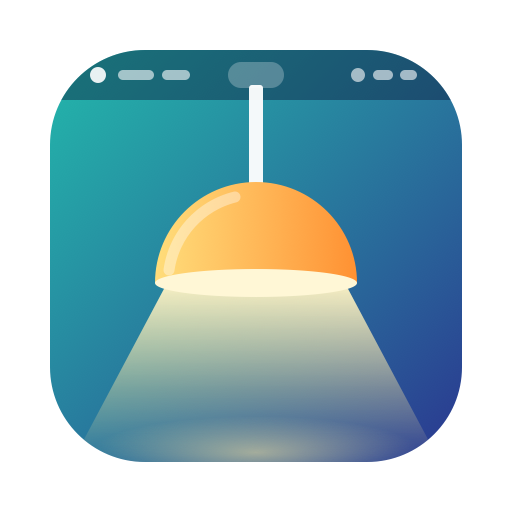
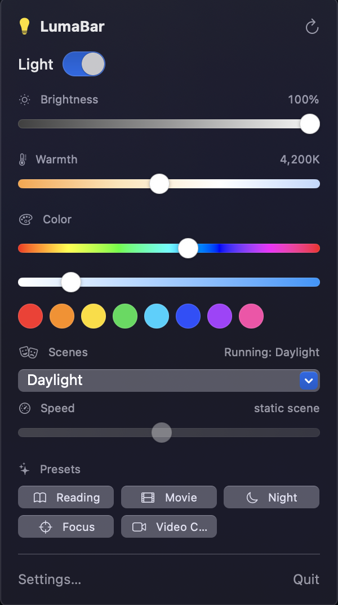

<p align="center">
  
</p>

<h1 align="center">LumaBar</h1>

<p align="center">
  Control your smart bulbs from the Mac menu bar, over your local network.<br>
  No cloud account. No hub. No HomePod.
</p>

<p align="center">
  <a href="https://github.com/Jotharsh/LumaBar/releases/latest"></a>
  
  
  <a href="LICENSE"></a>
</p>

<p align="center">
  
</p>

---

LumaBar lives in your menu bar and talks directly to your bulbs on your Wi-Fi: **WiZ, Tuya / Smart Life, Yeelight, LIFX, Philips Hue**, and anything **Home Assistant** controls. Click the lightbulb to switch lights on and off, change brightness, warmth and colour, pick a scene, or recall a preset. Global hotkeys work from any app.

It's a Mac stand-in for the phone apps' local controls, in one place, for people who'd rather not open four different apps.

## Features

- **Light controls:** on/off, brightness, warm-to-cool white, colour (hue and saturation sliders plus swatches)
- **Scenes:** all 32 WiZ scenes by name, with a speed slider for animated ones. The popover shows the scene a bulb is actually running
- **Presets:** Reading, Movie, Night, Focus and Video Call, all editable
- **Several brands at once:** each brand is a driver you switch on in Settings. The controls shown match what each bulb can do (a white-only bulb gets no colour picker)
- **Auto-discovery** where the brand allows it, with a manual IP fallback. Bulbs are remembered between launches
- **Clear help when something's wrong:** if a bulb can't be reached, LumaBar says why and what to check for *that brand*
- **Global hotkeys:** toggle light `⌃⌥L`, brightness up `⌃⌥↑`, brightness down `⌃⌥↓` (rebind in Settings ▸ Shortcuts)
- **Menu bar only:** no Dock icon, no windows in your way
- **Private:** everything stays on your network (see [Privacy](#privacy))

**Optional automations** (Settings ▸ Automations, all off by default): turn the light a colour during calendar meetings, dim and warm it after sunset, mirror your screen's colour, or switch to a "Video Call" preset when your camera turns on. When several apply at once, a video call beats a meeting, a meeting beats screen sync, and the light goes back to how it was when the last one ends.

## Supported brands

| Brand | How it talks to the bulb | Setup |
|---|---|---|
| **WiZ** | UDP, auto-discovery | Turn on **Allow local communication** in the WiZ app (Settings ▸ Security). Usually on by default |
| **Tuya / Smart Life** | Local TCP, protocol 3.3 and 3.4 | Needs the bulb's **device ID, IP address and local key**. The setup wizard includes a guide to getting the key from a free Tuya developer account |
| **Yeelight** | Local TCP, auto-discovery | Turn on **LAN Control** in the Yeelight app (open the bulb, then its settings). Some newer app versions and models hide this option |
| **LIFX** | UDP, auto-discovery | Nothing. Just be on the same Wi-Fi |
| **Philips Hue** | The bridge's local API | Click Find Bridges, press the bridge's link button, click Pair |
| **Home Assistant** | REST API | Your server address and a long-lived access token (profile ▸ Security) |

> **Honest status:** only **WiZ** has been verified against a real bulb. The other drivers are tested against simulated devices that implement each protocol, which shows the code follows the published protocol and handles errors, but not that it works with your exact bulb. Reports for Tuya, Yeelight, LIFX, Hue and Home Assistant are very welcome: please [open an issue](https://github.com/Jotharsh/LumaBar/issues/new?template=bug_report.md) with your bulb model and what happened.

## Install

**Requirements:** macOS 13 (Ventura) or later, Apple Silicon or Intel, and your Mac on the same Wi-Fi network as the bulbs.

1. Download **`LumaBar-1.0.2.dmg`** from the [latest release](https://github.com/Jotharsh/LumaBar/releases/latest).
2. Open the DMG and drag **LumaBar** onto the **Applications** shortcut.
3. Eject the DMG, then open **LumaBar** from Applications.
4. Look for the **lightbulb icon at the top right of your menu bar** and click it. (There's no Dock icon and no window.)
5. When macOS asks to allow **Local Network** access, click **Allow**. LumaBar can't see your bulbs without it.

### The first launch: macOS will warn you

LumaBar isn't signed with a paid Apple Developer certificate or notarized by Apple yet, so macOS shows *"LumaBar can't be opened because Apple cannot check it for malicious software."* This is expected for an indie app and doesn't mean anything is wrong. To open it anyway:

- **macOS 15 (Sequoia) or later:** try to open it once, then go to **System Settings ▸ Privacy & Security**, scroll down to the message about LumaBar, and click **Open Anyway**.
- **macOS 13 or 14:** right-click (or Control-click) LumaBar in Applications, choose **Open**, then click **Open** again.
- Or, from Terminal: `xattr -dr com.apple.quarantine /Applications/LumaBar.app`

You only have to do this once. If you'd rather not trust a binary, [build it from source](#build-from-source) in two minutes.

### Start at login

System Settings ▸ General ▸ Login Items ▸ **+** ▸ choose LumaBar.

### Uninstall

Quit LumaBar from its menu, then drag it from Applications to the Trash. To remove its saved settings too, run
`defaults delete io.github.jotharsh.LumaBar`. Any Tuya, Hue or Home Assistant keys you added are in **Keychain Access** under the name `io.github.jotharsh.LumaBar`.

## Getting started

1. **WiZ bulbs:** make sure "Allow local communication" is on in the WiZ app, open LumaBar, and it finds your bulbs on its own. If it doesn't, **Settings ▸ Bulbs ▸ Add by IP**.
2. **Other brands:** open **Settings ▸ Drivers**, switch the brand on, and follow the steps shown under it.
3. Click the lightbulb in the menu bar. Use the sliders, scenes and presets. If you have several bulbs, a picker at the top chooses one or **All bulbs**.

## Troubleshooting

If LumaBar shows **"Can't reach …"** or **"No bulbs found"**, it names the brand and lists what to check. The common causes:

- **macOS is blocking LumaBar from your local network.** This is the most common one on a fresh install, and after updating the app. LumaBar shows a red box saying so, with a button to **System Settings ▸ Privacy & Security ▸ Local Network**. Switch LumaBar on there (if it's already on, switch it off and on again), then click **Try Again**. In the card, **More things to check ▸ Technical detail** shows the exact reason macOS gave.
- **The bulb's own app setting is off:** WiZ needs *Allow local communication*; Yeelight needs *LAN Control*.
- **Different networks:** your Mac and the bulb must be on the same Wi-Fi (not a guest network, and with any VPN off). Routers with "client isolation" block local traffic.
- **Local Network permission:** System Settings ▸ Privacy & Security ▸ **Local Network** ▸ make sure LumaBar is on.
- **A changed IP address:** LumaBar re-searches automatically, but giving the bulb a fixed IP in your router is the most reliable fix.
- **Tuya:** the local key changes whenever the bulb is re-paired in the Tuya app. Fetch the new one and run setup again.

If it still doesn't work, [open an issue](https://github.com/Jotharsh/LumaBar/issues/new?template=bug_report.md). Don't paste local keys or tokens.

## Privacy

- LumaBar talks only to your bulbs, bridges and (if you set it up) your Home Assistant server. **There is no analytics, tracking or account.**
- The only optional internet request is Hue's "Use Philips' online lookup" button, which asks Philips which bridges are on your network. It's off unless you click it.
- **Tuya local keys, Hue pairing keys and the Home Assistant token are stored in the macOS Keychain**, never in plain-text settings or in the source. (Hue's local API puts its key in the request URL by design, so that key crosses your home network over plain HTTP.)
- The automations are opt-in and each asks for its own permission: **Calendars** (meeting colour; events are read on your Mac only), **Location** (sunset time; stored locally), **Screen Recording** (screen colour sync; the screen is reduced to one average colour and never saved or sent anywhere).

## Known limitations

- Not notarized yet (see [the first launch](#the-first-launch-macos-will-warn-you)).
- Only WiZ is verified on real hardware ([details above](#supported-brands)).
- Yeelight bulbs reject more than about 60 commands a minute, so very fast slider drags are spaced out.
- Tuya assumes a 2700-6500 K range, which is right for most but not all bulbs.
- LIFX's list of white-only models is partial; unknown models are treated as colour bulbs.
- Home Assistant needs version 2022.11 or newer.
- The permission-gated automations (calendar, sunset, screen sync) have not been exercised on real data.

## Build from source

You need macOS 13+ and Xcode (or its command line tools) with Swift 5.9+.

```sh
git clone https://github.com/Jotharsh/LumaBar.git
cd LumaBar
swift build                  # debug build
swift test                   # ~230 tests, all against simulated devices: no bulbs needed
./scripts/build.sh           # dist/LumaBar.app (release, universal, ad-hoc signed)
./scripts/make_dmg.sh        # dist/LumaBar.dmg
open dist/LumaBar.app
```

`build.sh` reads optional environment variables: `BUNDLE_ID`, `VERSION`, `BUILD_NUMBER`, and `ARCHS` (for example `ARCHS=arm64`).

No bulb handy? `python3 scripts/fake_bulb.py` pretends to be a WiZ bulb (see the script's header for how to point the app at it).

### Signing and notarizing a release

Needs a paid Apple Developer account. This is what removes the first-launch warning.

```sh
export DEVELOPER_ID_APPLICATION="Developer ID Application: Your Name (TEAMID)"
xcrun notarytool store-credentials "lumabar" --apple-id you@example.com --team-id TEAMID --password <app-specific-password>
export NOTARY_PROFILE="lumabar"
./scripts/build.sh && ./scripts/sign_notarize.sh
```

Credentials are only ever read from the environment. The script signs with the hardened runtime, builds and signs the DMG, notarizes it, staples the ticket and runs a Gatekeeper check.

## Project layout

```
Sources/LumaBarCore/        no UI, unit tested
  Drivers/BulbDriver.swift  the protocol every brand implements, plus capabilities, errors and help text
  Drivers/DriverRegistry    runs discovery across the enabled drivers and merges the results
  Drivers/SecretStore       Keychain-backed storage for keys and tokens
  Drivers/Wiz|Tuya|Yeelight|Lifx|Hue|HomeAssistant/    one folder per brand
Sources/LumaBar/            the app
  BulbStore.swift           state and per-bulb command queue; talks to drivers only through BulbDriver
  Views/                    the popover, Settings, and a setup wizard per brand
  Automations/              calendar, sunset, screen sync, webcam (work with every brand)
Tests/                      protocols, crypto, every driver against simulated devices, store behaviour
scripts/                    build, DMG, signing and notarization, icon generation, a fake bulb
```

Adding a brand means implementing `BulbDriver`, giving it a help text, registering it in `Sources/LumaBar/Drivers.swift`, and writing tests against a simulated device. See [CONTRIBUTING.md](CONTRIBUTING.md).

## Contributing

Issues and pull requests are welcome. The most helpful thing is testing with real bulbs and reporting the results. See [CONTRIBUTING.md](CONTRIBUTING.md) and the [changelog](CHANGELOG.md).

## License

[MIT](LICENSE). LumaBar uses [KeyboardShortcuts](https://github.com/sindresorhus/KeyboardShortcuts) by Sindre Sorhus (MIT); see [THIRD_PARTY_NOTICES.md](THIRD_PARTY_NOTICES.md).

LumaBar is an independent project and is not affiliated with or endorsed by WiZ, Signify (Philips Hue), Tuya, Yeelight, LIFX or Home Assistant. All product names are trademarks of their respective owners.
